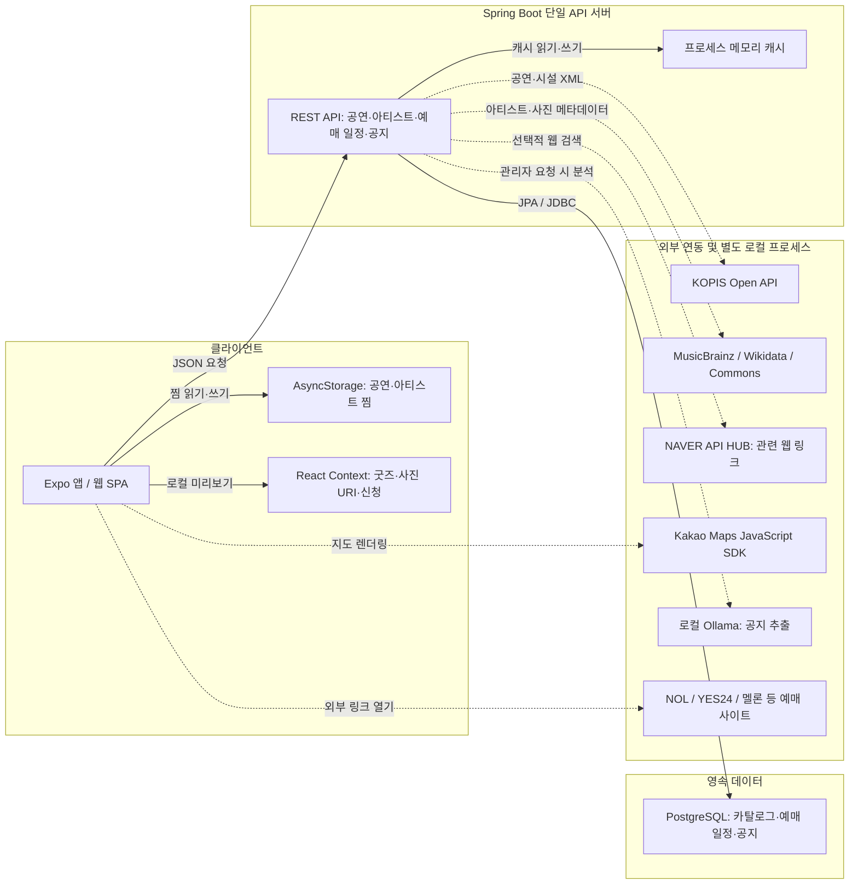

# StagePin 시스템 아키텍처

작성일: 2026-10-28. 기준: `1d997cd`와 작성 시점의 로컬 작업 트리.
AI 관련 미커밋 변경도 반영했다. 운영 배포 반영 여부와 서버 가동 상태까지 검증한 문서는 아니다.

## 1. 서비스와 구현 범위

StagePin은 **공연·예매 일정 탐색과 팬 굿즈 판매·교환을 연결하는 서비스**다.
현재는 Expo 클라이언트와 도메인 패키지로 나눈 Spring Boot 단일 API 서버 구조다.
마이크로서비스, 메시지 큐, 분산 캐시는 사용하지 않는다.

| 영역 | 현재 동작 | 저장 위치 |
| --- | --- | --- |
| 공연 탐색·검색·상세 | KOPIS 조회, 과거 공연 검색, 포스터·예매처 링크·공연장 표시 | 서버 메모리 캐시. KOPIS 응답 자동 DB 저장 없음 |
| 아티스트 검색·사진 | MusicBrainz 이름·별칭, Wikidata 이미지 연결, Commons 사진·이용 정보 | 서버 메모리 캐시 |
| 공연·아티스트 찜 | 기기 내 저장, 홈 일정 필터 | AsyncStorage. 서버 계정 동기화 없음 |
| 선예매·일반예매 | 확인한 예매 일정 조회·등록 | PostgreSQL `ticket_opening` |
| AI 공지 분석·검수 | 원문 입력 → 로컬 모델 추출 → 운영자 수정·승인 | `ticket_notice`, 승인 시 `ticket_opening` 생성 |
| 공연장 지도 | 탐색 지도, 상세 카카오맵 | 공연 응답의 좌표 |
| 굿즈 판매·교환 | 목업 목록·필터, 등록·사진 첨부·찜·신청 미리보기 | React Context 메모리. 새로고침 시 초기화 |
| 현장 교환 | 거래 방식·공연명 입력과 목록 필터 | 굿즈 목업 속성. 매칭·채팅·위치 공유 없음 |
| 일정 탭 | 가상 일정 달력 디자인 | 화면 내 목업. 홈의 실제 일정 피드와 다름 |
| 로그북·모의 티켓팅 | 이전 화면·코드 보존 | 핵심 진입점 제외, 로그북 하단 탭 숨김 |

## 2. 논리 아키텍처

선은 호출·접근 경로다. 외부 연동의 점선은 비동기 처리나 메시지 큐를 뜻하지 않는다.



- 예매는 외부 예매처에서 한다. StagePin 좌석 예약·결제 서버는 없다.
- 굿즈 사진은 선택한 URI/웹 데이터 URL을 메모리에 보관한다. 서버 업로드·S3 저장은 없다.
- 아티스트 검색의 MusicBrainz ID와 DB `artist.id`는 별도 식별자 체계다. 통합 마스터 매핑은 없다.
- KOPIS는 현재 서버 코드에 지정된 HTTP 주소로 호출한다. 앱이 KOPIS 키를 직접 쓰지 않는다.

## 3. 기술 구성과 책임

| 계층 | 현재 구성 | 책임 |
| --- | --- | --- |
| 화면 | React Native 0.88, React 19.3, Expo SDK 58, TypeScript | 웹·네이티브 공통 화면 |
| 라우팅 | Expo Router | 홈·일정·굿즈·MY와 상세/검색/관리자 화면 |
| 서버 상태 | TanStack Query | 기본 staleTime 60초, 재시도 1회. 화면별 재정의 가능 |
| 기기 상태 | Context, AsyncStorage | 세션성 굿즈와 영속 찜 분리 |
| 서버 | Java 21, Spring Boot 4.1.1, Spring MVC | REST, 외부 응답 변환, 입력 검증 |
| 저장 | Spring Data JPA, PostgreSQL, Flyway | 마이그레이션. Hibernate `ddl-auto=validate` |
| AI | Spring AI 2.0.2, Ollama, 기본 `qwen3.5:4b` | 원문에서 필드와 인용 근거 추출. 모델 환경 변수 변경 가능 |
| 지도 | Kakao Maps JS SDK, 네이티브 상세 WebView | 좌표 표시. 상세 웹 키 누락·로딩 실패 시 지도 링크 제공 |
| 사진 선택 | Expo ImagePicker | 굿즈 사진 선택·미리보기 |

### 서버 모듈

```text
backend/src/main/java/com/leedahye/stagepin/
├── concert/    공연 목록·검색·상세, KOPIS, 장르·분류
├── artist/     DB Artist 엔티티, 외부 카탈로그
├── venue/      공연장 엔티티
├── schedule/   공연별 일정 엔티티
├── ticketing/  검증 예매 일정, AI 공지 분석·승인
├── search/     NAVER 관련 링크
└── common/     보안 설정, CORS, 오류 처리
```

엔티티가 있다고 전체 CRUD API가 구현된 것은 아니다. 공연장·DB 아티스트의 독립 운영 CRUD는 없다.

## 4. 실행·배포 구성

| 환경 | 프런트 | API | DB | AI |
| --- | --- | --- | --- | --- |
| 로컬 | Expo 개발 서버 `8081` | Compose `api`, 호스트 `8080` | Compose `database`, PostgreSQL 17, 볼륨 | 호스트 Ollama. 기본 주소 `host.docker.internal:11434` |
| 웹 배포 설정 | Vercel: export `dist`, SPA rewrite | Render: backend Dockerfile | Render 별도 PostgreSQL 서비스 | Render 설정에 Ollama 서비스 없음 |
| iOS 개발 빌드 | Xcode/Expo 앱 설치 | 빌드에 지정한 API URL | API를 통해 접근 | API에서 접근 가능한 모델 서버 필요 |

웹 도메인은 `https://stage-pin.vercel.app`, API 주소는 빌드 시 `EXPO_PUBLIC_API_URL`로 결정된다.
Dockerfile은 Gradle 빌드와 JRE 실행을 분리하고 비루트 사용자로 실행한다.
Compose DB는 호스트 포트 노출 없이 API와 내부 네트워크로 연결한다.
웹 배포가 네이티브 설치 앱을 자동 갱신하거나 로컬 Ollama를 Render로 배포하지는 않는다.

### 설정·보안 경계

- 서버 전용: `KOPIS_API_KEY`, 선택적 NAVER 자격 정보, `STAGEPIN_ADMIN_KEY`, DB 자격 정보.
- 공개 클라이언트 설정: `EXPO_PUBLIC_API_URL`, `EXPO_PUBLIC_KAKAO_MAP_JAVASCRIPT_KEY`. Expo 공개 환경 변수는 비밀 저장소가 아니다.
- Kakao JS 키는 허용 도메인 설정이 필요한 공개 클라이언트 키다.
- 관리자 API는 서비스 계층에서 `X-StagePin-Admin-Key`를 검사한다. 키 미설정은 503, 잘못된 키는 403이다.
- Spring Security 필터에서 지정 API 경로를 허용한 뒤 관리자 서비스에서 키를 검사한다. 나머지 경로는 거부한다.
- 서버 세션은 STATELESS이며 일반 사용자 로그인·JWT·역할 시스템은 없다. CORS는 인증을 대신하지 않는다.
- 공지 원문은 관리자가 입력한다. 입력된 출처 URL을 자동 크롤링하지 않는다.

## 5. 조회와 캐시 한계

| 조회 | 서버 캐시 | 현재 제한 |
| --- | --- | --- |
| KOPIS 예정 공연 | 장르별 30분 | 요청일~30일 뒤, 첫 페이지 최대 100건에서 상세 로딩 최대 12건 |
| KOPIS 검색 | 장르·검색어별 30분 | 2014-01-01~현재+30일, 첫 페이지 최대 100건에서 최대 30건 반환 |
| 아티스트 검색 | 검색어별 6시간 | 최대 5명. 사진 이용 정보 미확인 시 기본 아이콘 |
| NAVER 웹 검색 | 검색어별 30분 | 관련 링크 5건. 자격 정보 미설정 시 비활성 |
| 검증 예매 일정 | DB 조회 | 오픈 예정 최대 50개, 시간 오름차순 |

캐시는 Redis가 아니라 JVM 메모리다. 재시작 시 사라지고 인스턴스 간 공유되지 않는다.
홈은 KOPIS 응답 중 종료·취소되지 않은 공연을 시작일 순으로 표시한다.
관심 아티스트 매칭은 이름·별칭 정규화 비교이며 출연진 누락을 해결하는 엔티티 매칭 시스템은 아니다.
검색 지도의 지역 대표 좌표는 시설 위치와 다를 수 있고 상세 조회 성공 시 시설 좌표로 보완한다.
KOPIS 장애 시 API가 DB의 한국 데모 공연을 반환할 수 있지만 홈의 실제 공연 필터는 데모를 제외한다.

## 6. CI와 관측 가능성

`.github/workflows/ci.yml`: PR과 `main` push에서 실행.

- Backend: Java 21, `./gradlew test --no-daemon`.
- Mobile: Node 24, `npm ci`, lint, TypeScript 검사, Node 테스트, `expo-doctor`.
- Vercel에서 `npm run build:web` 수행. 현재 GitHub CI 자체에 웹 export 단계는 없다.
- 헬스체크 `/actuator/health`, AI 공지에 모델·프롬프트 버전·지연 시간·토큰 수 저장.
- 중앙 로그·분산 트레이싱·사용자 행동 분석 파이프라인은 구현된 것으로 보지 않는다.

## 7. 미구현 운영 기능

회원 인증, 굿즈 DB/API, 사진 업로드, 소유권 검증, 채팅, 실시간 현장 매칭,
결제·환불·배송, 푸시 알림, 대량 수집 배치, 검색 엔진, 거래 분쟁·신고 처리는 미구현이다.

## 문서와 소스 근거

- [실제 DB ERD와 클라이언트 모델](erd.md), [데이터 흐름과 API](data-flows.md)
- [굿즈 로드맵](fan-market-roadmap.md), [사진 출처 정책](artist-profile-sources.md)
- DB: `backend/src/main/resources/db/migration/V1`, `V3`, `V4` SQL. `V2`는 데모 입력.
- 서버: `ConcertService`, `KopisConcertClient`, `ArtistCatalogClient`, `TicketOpeningService`, `TicketNoticeService`, `SecurityConfig`.
- 앱: `mobile/src/api/concerts.ts`, `src/lib/favorites.tsx`, `src/lib/goods-demo-state.tsx`, `src/lib/goods-demo.ts`.
- 인프라: `infra/compose.yaml`, `backend/Dockerfile`, `render.yaml`, `mobile/vercel.json`.
