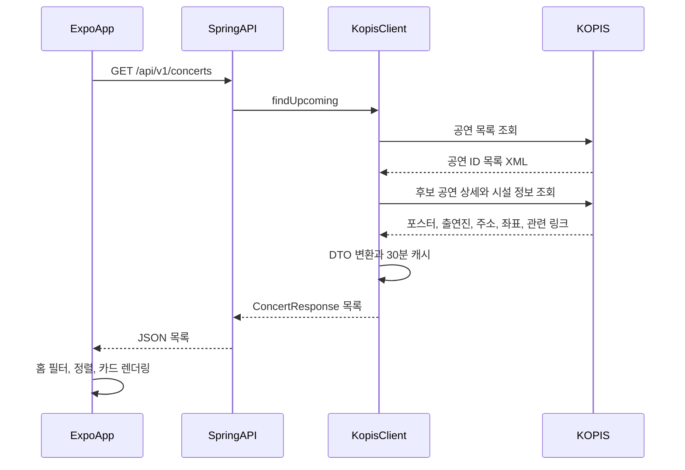
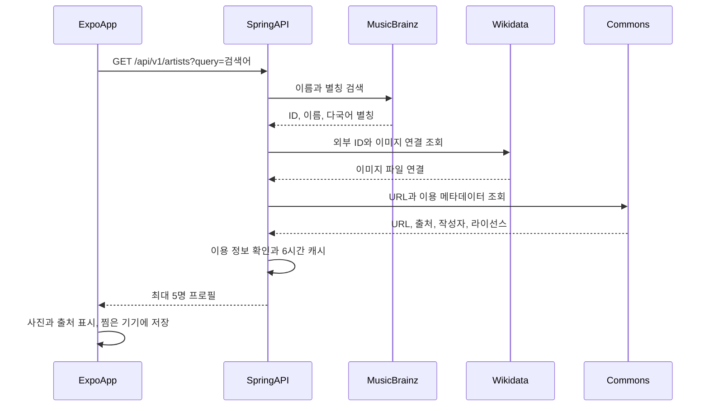
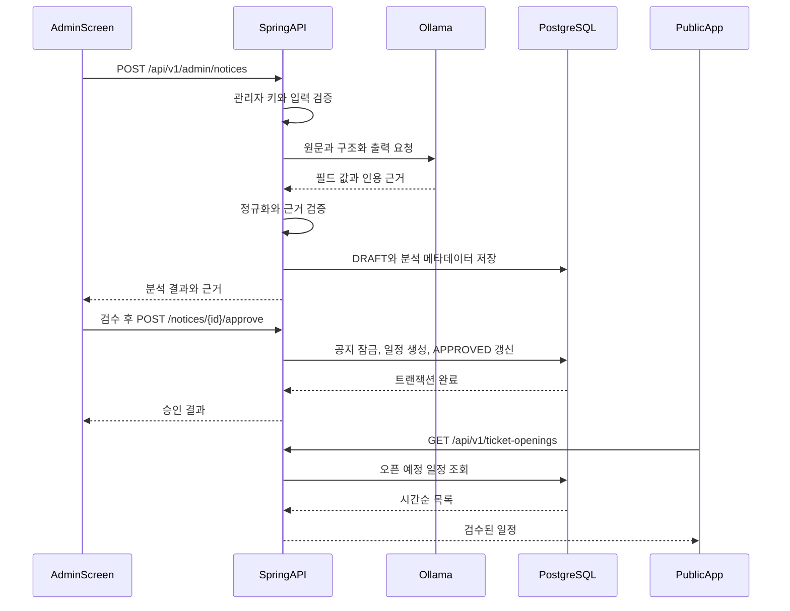
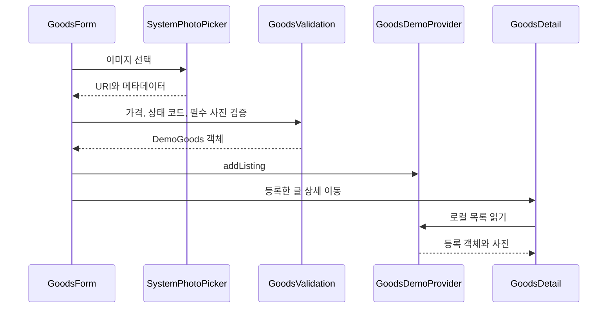

# StagePin 주요 데이터 흐름과 API

작성일: 2026-10-28. 현재 로컬 소스 기준. 자동 수집·결제·거래 시스템을 가정하지 않는다.

## 1. 공연 목록 조회

캐시 미스 후 KOPIS 조회가 성공하는 경로다.

캐시 히트 시 외부 요청을 생략한다. 결과가 없거나 오류가 나면 `POPULAR_MUSIC`에 한해
DB 한국 데모 공연 조회를 시도한다. 홈은 `source=KOPIS`만 표시하므로 데모를 반환해도 빈 상태가 될 수 있다.

검색은 같은 목록 API의 `query`를 사용한다. 검색 장애는 빈 목록으로 처리하며 DB 데모 검색으로 대체하지 않는다.
과거 공연 검색의 지역 대표 좌표는 상세 시설 조회가 성공하면 실제 좌표로 보완한다.
UUID를 원본 KOPIS ID로 되돌리는 별도 영속 인덱스가 없어 캐시에 없는 과거 공연의 직접 상세 링크는 실패할 수 있다.

## 2. 아티스트 검색과 프로필 사진

홈 검색은 450ms 디바운스를 적용한다. 아티스트 선택은 `/artists/[id]`, 공연명 검색은 `/search`로 이동한다.
아티스트 검색과 공연 검색은 별개 API이며 모든 가수·모든 공연의 완전한 커버리지를 보장하지 않는다.
사진이 없거나 이용 메타데이터가 기준에 맞지 않으면 기본 아이콘을 쓴다.
[사진 표시 정책](artist-profile-sources.md)을 별도로 따른다.

## 3. AI 공지 분석 → 사람 검수 → 일정 공개

아래 두 POST는 별도 관리자 행동이며 분석만으로 일정이 공개되지 않는다.

- 관리자가 출처 URL과 원문을 입력한다. URL 자동 크롤링·예매처 전체 수집기는 없다.
- 추출: 아티스트명, 공연명, 공연장, 공연 기간, 인증 기간, 선예매일, 일반예매일, 예매처, 예매 링크.
- 값이 있는 필드는 원문에 포함된 연속 인용 근거를 요구한다. 이 검증만으로 의미적 정확성이 보장되지는 않아 사람 검수가 필요하다.
- 모델 호출은 DB 트랜잭션 밖에서 한다. Ollama 미실행·모델 부재 시 분석이 실패한다.
- 승인은 `PESSIMISTIC_WRITE` 행 잠금과 트랜잭션을 사용한다. 같은 공지가 승인되어 있으면 기존 결과를 반환한다.
- 승인된 날짜를 `ticket_opening`으로 만든다. 공연장·기간 등 모든 추출 필드를 공연 테이블에 반영하는 것은 아니다.
- 서로 다른 원본 공지에서 중복 일정을 만드는 것을 막는 유니크 제약은 아직 없다.
- 원문, 추출/검수 결과, 모델, 프롬프트 버전, 지연 시간, 토큰 수를 기록한다.
- 최신 작업 트리는 로컬 Ollama 연결 기준이다. Render Blueprint에 모델 실행 환경은 포함되지 않는다.

## 4. 굿즈 등록과 거래 신청 미리보기

API 서버와 DB 호출은 없다. 사진은 서버에 업로드되지 않고 새로고침하면 글과 함께 사라진다.
목록은 첫 사진, 상세는 선택한 첨부 사진을 표시한다.
거래 신청 역시 `requested` 배열에 ID를 넣는 목업이다. 상대방 전송·주문·결제·채팅은 없다.

## 5. 실제 서버 API

| 메서드 | 경로 | 입력 | 책임/접근 |
| --- | --- | --- | --- |
| GET | `/api/v1/concerts` | `from?`, `query?`, `genre?` | 예정 공연/공연명 검색. 공개 |
| GET | `/api/v1/concerts/{id}` | UUID, `genre?` | DB 또는 KOPIS 캐시 기반 상세. 공개 |
| GET | `/api/v1/artists` | `query` | 외부 이름·별칭·사진. 공개 |
| GET | `/api/v1/search/naver` | `query` | 선택적 관련 웹 링크. 공개 |
| GET | `/api/v1/ticket-openings` | `from?` | 예정 검증 일정 최대 50개. 공개 |
| POST | `/api/v1/admin/ticket-openings` | 공연·아티스트명, 타입, 시간·시간대, 예매처·링크·출처 | 일정 직접 등록. 관리자 |
| GET | `/api/v1/admin/notices` | 관리자 헤더 | 최근 공지 최대 30개. 관리자 |
| POST | `/api/v1/admin/notices` | `sourceUrl`, `text` | AI 분석·초안 저장. 관리자 |
| POST | `/api/v1/admin/notices/{id}/approve` | 수정한 `NoticeExtraction` | 검수 승인. 관리자 |
| GET | `/actuator/health` | 없음 | 헬스체크 |

관리자 헤더는 `X-StagePin-Admin-Key`다. 실제 키는 문서·예제에 기록하지 않는다.
`/goods`, `/orders`, `/payments`, `/auth`, `/chat` **서버 API는 없다**.

## 6. 포트폴리오 설명 포인트

- 외부 XML/JSON을 동일 공연 DTO로 변환하고 캐시·장애 대체 응답을 분리.
- 공연일과 예매 오픈일의 출처·저장 모델 분리.
- AI 자동 공개 대신 근거 검증·사람 승인·행 잠금으로 공개 경계 설정.
- 서버 데이터, 기기 영속 찜, 세션성 굿즈 미리보기의 수명 분리.
- 외부 사진의 URL뿐 아니라 작성자·라이선스·출처 메타데이터 전달.

굿즈 실거래·대규모 동시성 처리·결제를 이미 운영한 것으로 설명하지 않는다.
근거: 각 Controller/Service/Client 및 `mobile/src/api/concerts.ts`, `HomeSearch.tsx`, `goods/create.tsx`.
관련: [아키텍처](architecture.md), [ERD](erd.md).

내 일정 탭은 이제 목업 달력이 아닌 기기 저장 일정이다. 공연 상세에서 선택한 공연 시작일·확인된 예매일을
AsyncStorage에 저장하고 달력에서 조회한다. 아티스트 찜·예매 완료와 구분하며
구체적인 범위와 날짜 한계는 [내 일정 흐름](personal-schedule.md)을 참고한다.
