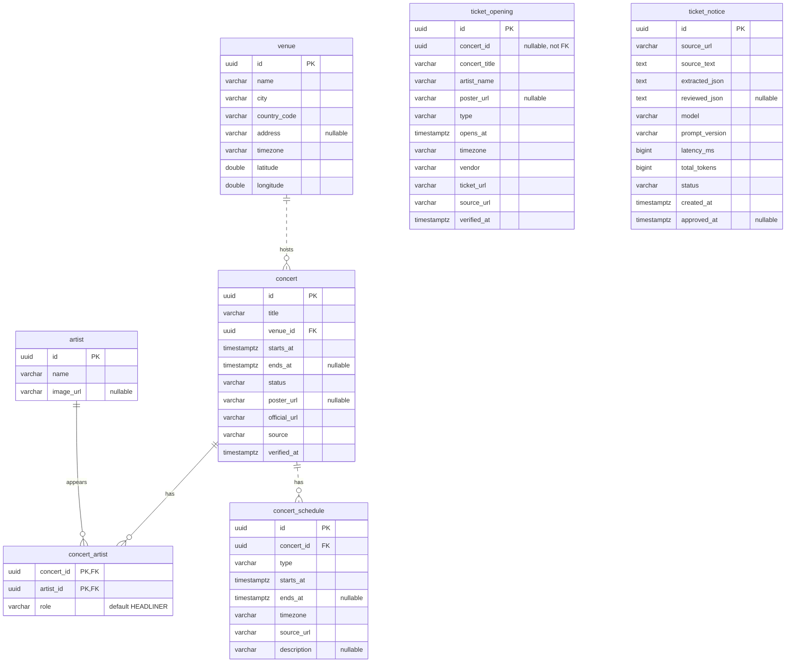
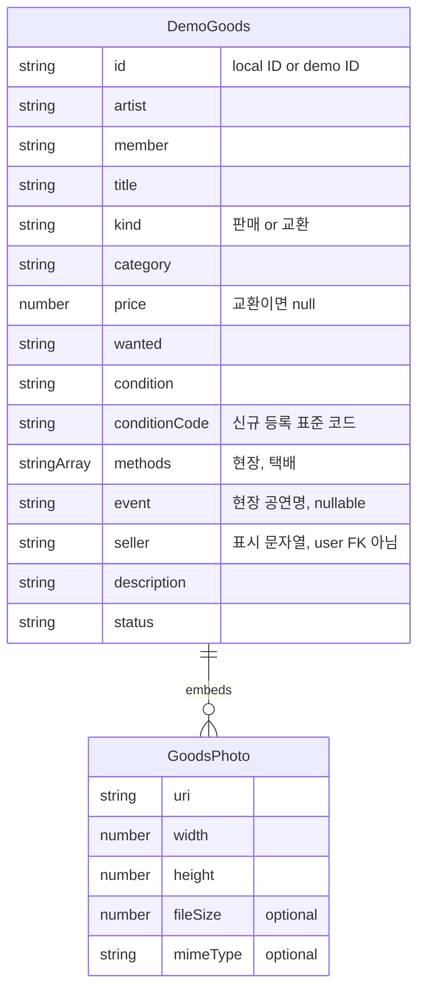

# StagePin ERD와 데이터 저장 경계

작성일: 2026-10-28. Flyway V1~V4와 현재 소스 기준이다.
운영 DB에 접속해 역공학한 결과는 아니며 Flyway 이력 테이블을 제외한 애플리케이션 테이블 7개를 표시한다.

## 1. 실제 DB ERD

FK가 있는 관계만 선으로 연결했다. `ticket_opening.concert_id`는 UUID 컬럼이지만 **FK 제약이 없다**.
`ticket_notice`와 승인 결과 `ticket_opening` 사이에도 참조 컬럼이 없어 연결선을 만들지 않았다.

`||`은 정확히 하나, `o{`는 0개 이상이다. 실선은 부모 키가 자식 PK에 포함되는 식별 관계,
점선은 자식이 독립 PK를 갖는 비식별 관계다. 점선이 FK가 없다는 뜻은 아니다.

### 관계·제약

| 관계/제약 | 현재 DDL |
| --- | --- |
| 공연장 : 공연 | 1:N, `concert.venue_id` 필수 FK |
| 공연 : 아티스트 | N:M, 연결 테이블의 복합 PK `(concert_id, artist_id)` |
| 공연 : 공연별 일정 | 1:N, `concert_schedule.concert_id` 필수 FK |
| 공연 삭제 | 연결된 `concert_artist`, `concert_schedule`은 `ON DELETE CASCADE` |
| 공연장·아티스트 삭제 | 참조 행이 있으면 기본 FK 동작으로 제한. 연쇄 삭제 선언 없음 |
| 공연/일정 기간 | `ends_at IS NULL OR ends_at >= starts_at` CHECK |
| 공연장 좌표 | 위도 -90~90, 경도 -180~180 CHECK |
| ticket_opening | 공연명·아티스트명 별도 저장. 카탈로그 공연 없이도 등록 가능 |
| ticket_notice | 추출/검수 JSON은 TEXT. JSONB 타입이나 JSON 내부 FK가 아님 |

### 보조 인덱스

PK 인덱스 외에 아래 인덱스가 정의되어 있다.

| 이름 | 컬럼 | 목적 |
| --- | --- | --- |
| `idx_concert_starts_at` | `concert(starts_at)` | 예정 공연 |
| `idx_schedule_concert` | `concert_schedule(concert_id, starts_at)` | 공연별 일정 |
| `idx_ticket_opening_opens_at` | `ticket_opening(opens_at)` | 가까운 예매 일정 |
| `idx_ticket_notice_created_at` | `ticket_notice(created_at DESC)` | 최근 분석 공지 |

### 상태와 식별자

- 공연 상태, 일정 종류, 예매처는 VARCHAR에 Java enum 이름을 저장한다. DB enum/코드 테이블은 없다.
- `concert_artist.role`은 DDL에 있으나 JPA `ManyToMany`에서 별도 속성으로 다루지 않는다.
- 공지는 생성 시 `DRAFT`, 승인 시 `APPROVED`. 모델 실패를 성공 공지 레코드로 저장하지 않는다.
- KOPIS 응답 UUID는 원본 ID에서 생성하는 안정 ID다. 생성만으로 DB 행이 삽입되지는 않는다.
- MusicBrainz 검색 ID와 DB `artist.id`를 연결하는 영속 매핑 테이블은 없다.
- 승인 일정에 `notice_id`가 없어 DB 관계만으로 원본 공지와 직접 JOIN할 수 없다.

## 2. DB가 아닌 굿즈 데이터 모델

아래는 **TypeScript 객체 구조**다. SQL 테이블·FK·서버 API가 아니다.
목업 8개와 사용자가 앱 안에서 등록한 글을 `GoodsDemoProvider`가 메모리에 보관한다.

목업은 샘플 일러스트를 써서 사진이 `0..N`이다. 신규 등록에는 검증 함수가 **사진 1~5장**을 강제한다.
화면 장식 필드 `color`, `ink`, `mark`, 표시 시간 `time`은 위 도식에서 생략했다.
사진은 독립 ID 없이 배열로 포함되고 첫 사진이 대표 이미지다.

### 등록 검증

| 항목 | 현재 구현 |
| --- | --- |
| 가격 | 숫자 외 문자 제거. 등록 시 1~100,000,000원 정수 |
| 상태 | 정해진 코드 선택, 등록 객체에 코드와 표시명 저장 |
| 사진 | 1~5장. 크기 메타데이터가 있으면 장당 10MB 이하 |
| 형식 | 제공된 MIME이 JPEG/PNG/WebP/HEIC/HEIF/AVIF인지, 이미지 크기가 양수인지 검증 |
| 방식 | 현장·택배 중 하나 이상. 현장이면 공연명 필수 |
| 교환 | 구하는 굿즈 필수, 가격은 `null` |

| 상태 코드 | 표시명 |
| --- | --- |
| `SEALED` | 미개봉 |
| `OPENED_UNUSED` | 개봉 · 미사용 |
| `USED_GOOD` | 사용감 적음 |
| `USED_FAIR` | 사용감 있음 |
| `DAMAGED` | 하자 있음 |

클라이언트 검증이므로 향후 업로드 서버에서 실제 파일 내용·크기·소유권을 다시 검증해야 한다.

## 3. 찜·신청 저장 위치

| 데이터 | 구조 | 수명 |
| --- | --- | --- |
| 아티스트 찜 | `ArtistSearchResult[]` | AsyncStorage `stagepin:favorites` |
| 공연 찜 | `Concert[]` | 같은 키의 `concerts` 배열 |
| 굿즈 찜 | `saved: string[]` | React Context 메모리 |
| 거래 신청 | `requested: string[]` | React Context 메모리, 상대방 전송 없음 |
| 등록 글·사진 | `items: DemoGoods[]` | React Context 메모리, 서버 업로드 없음 |

현재 `user`, `goods`, `goods_photo`, `favorite`, `trade`, `order`, `payment`, `chat_message` 테이블은 없다.

## 4. 다음 설계 과제 — 미구현

1. 회원과 등록자·찜·신청의 관계 및 소유권 검증.
2. 굿즈·사진 영속 저장, 파일 저장 키와 공개 URL 분리.
3. 현장 교환 공연을 문자열에서 검증 가능한 공연 ID로 연결.
4. 승인 예매 일정에 공지 참조를 추가해 출처 추적 강화.
5. 외부 아티스트 ID와 내부 아티스트 ID 매핑.

근거: `backend/src/main/resources/db/migration/V1__create_concert_catalog.sql`,
`V3__create_verified_ticket_openings.sql`, `V4__create_ticket_notice.sql`,
`mobile/src/lib/goods-demo.ts`, `goods-demo-state.tsx`, `favorites.tsx`.

관련: [아키텍처](architecture.md), [데이터 흐름](data-flows.md).
