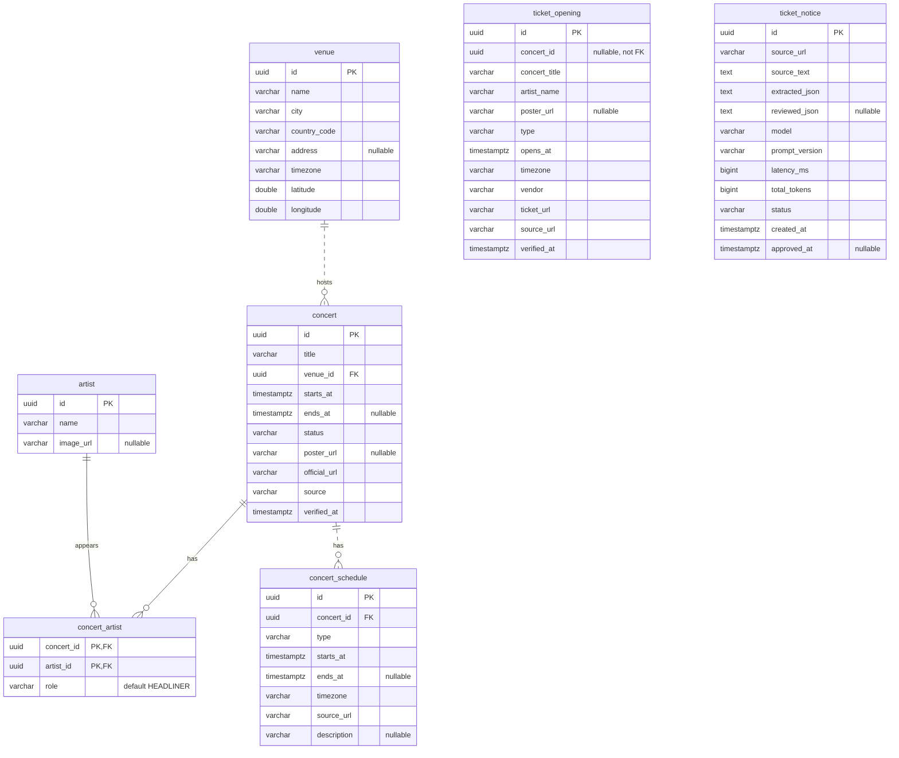
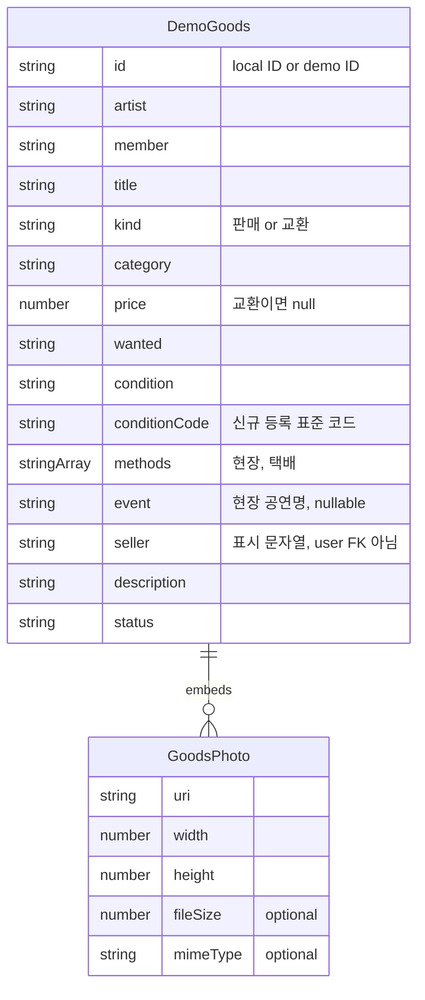

# StagePin ERD와 데이터 저장 경계

기존 도식 작성일: 2026-10-28 (V1~V4의 7개 테이블).
2026-11-05: V5~V8의 회원/검색/굿즈 추가 테이블은 아래 별도 절에 반영했다.
운영 DB를 역공학한 문서는 아니다.

## 1. 실제 DB ERD

FK가 있는 관계만 선으로 연결했다. `ticket_opening.concert_id`는 UUID 컬럼이지만 **FK 제약이 없다**.
`ticket_notice`와 승인 결과 `ticket_opening` 사이에도 참조 컬럼이 없어 연결선을 만들지 않았다.

`||`은 정확히 하나, `o{`는 0개 이상이다. 실선은 부모 키가 자식 PK에 포함되는 식별 관계,
점선은 자식이 독립 PK를 갖는 비식별 관계다. 점선이 FK가 없다는 뜻은 아니다.

### 관계·제약

| 관계/제약 | 현재 DDL |
| --- | --- |
| 공연장 : 공연 | 1:N, `concert.venue_id` 필수 FK |
| 공연 : 아티스트 | N:M, 연결 테이블의 복합 PK `(concert_id, artist_id)` |
| 공연 : 공연별 일정 | 1:N, `concert_schedule.concert_id` 필수 FK |
| 공연 삭제 | 연결된 `concert_artist`, `concert_schedule`은 `ON DELETE CASCADE` |
| 공연장·아티스트 삭제 | 참조 행이 있으면 기본 FK 동작으로 제한. 연쇄 삭제 선언 없음 |
| 공연/일정 기간 | `ends_at IS NULL OR ends_at >= starts_at` CHECK |
| 공연장 좌표 | 위도 -90~90, 경도 -180~180 CHECK |
| ticket_opening | 공연명·아티스트명 별도 저장. 카탈로그 공연 없이도 등록 가능 |
| ticket_notice | 추출/검수 JSON은 TEXT. JSONB 타입이나 JSON 내부 FK가 아님 |

### 보조 인덱스

PK 인덱스 외에 아래 인덱스가 정의되어 있다.

| 이름 | 컬럼 | 목적 |
| --- | --- | --- |
| `idx_concert_starts_at` | `concert(starts_at)` | 예정 공연 |
| `idx_schedule_concert` | `concert_schedule(concert_id, starts_at)` | 공연별 일정 |
| `idx_ticket_opening_opens_at` | `ticket_opening(opens_at)` | 가까운 예매 일정 |
| `idx_ticket_notice_created_at` | `ticket_notice(created_at DESC)` | 최근 분석 공지 |

### 상태와 식별자

- 공연 상태, 일정 종류, 예매처는 VARCHAR에 Java enum 이름을 저장한다. DB enum/코드 테이블은 없다.
- `concert_artist.role`은 DDL에 있으나 JPA `ManyToMany`에서 별도 속성으로 다루지 않는다.
- 공지는 생성 시 `DRAFT`, 승인 시 `APPROVED`. 모델 실패를 성공 공지 레코드로 저장하지 않는다.
- KOPIS 응답 UUID는 원본 ID에서 생성하는 안정 ID다. 생성만으로 DB 행이 삽입되지는 않는다.
- MusicBrainz 검색 ID와 DB `artist.id`를 연결하는 영속 매핑 테이블은 없다.
- 승인 일정에 `notice_id`가 없어 DB 관계만으로 원본 공지와 직접 JOIN할 수 없다.

## 2. 현재 굿즈·회원 저장 (V5~V8)

- V5: `popular_search_term`. V6: `member_account`, `member_identity`, `member_login_attempt`, `member_session`. V7: 회원 email 추가.
- V8: `goods_listing`과 `goods_photo`. 현재 전체 애플리케이션 테이블은 14개다.
- `member_account.id` 1:N `goods_listing.owner_id` 필수 FK, `goods_listing.id` 1:N `goods_photo.listing_id` 필수 FK. 둘 다 부모 삭제 시 CASCADE다.
- 글의 `(owner_id, request_id)`는 유일해 재전송 중복을 막는다. 사진의 `(listing_id, position)`도 유일하며 순서는 0~4다.

| 테이블 | 주요 필드/제약 |
| --- | --- |
| goods_listing | UUID id/owner_id/request_id, artist, title, kind(SALE/EXCHANGE), price, wanted, condition_code, description, onsite/delivery, event, created_at |
| goods_photo | UUID id/listing_id, position, width/height(1~1600), content BYTEA(최대 2MB, 재인코딩 JPEG) |
| 판매 가격 | SALE이면 1~100,000,000원 NOT NULL, EXCHANGE이면 null + wanted 필수 |
| 방식 | onsite/delivery 중 하나 이상, onsite이면 event 필수 |
| 상태 | SEALED/OPENED_UNUSED/USED_GOOD/USED_FAIR/DAMAGED CHECK |

사진 1~5장은 서비스 검증이며, 글/사진을 한 트랜잭션으로 넣는다. 목록/상세 DTO에는 bytes 대신 공개 사진 URL/크기만 둔다.
원본 사진·GPS/EXIF는 저장하지 않는다. [검증·인증·확장 한계](goods-persistence.md) 참고.

### 과거 목업 표시 모델 (DB 아님)

아래는 **TypeScript 객체 구조**다. SQL 테이블·FK·서버 API가 아니다.
`DemoGoods` 타입과 샘플 데이터는 기존 UI/검증 호환 코드로 남아 있으나 실제 목록에 섞지 않는다.
현재 `GoodsProvider`는 서버 응답을 UI 객체로 매핑하며 글/사진의 원본은 DB에 있다.

목업은 샘플 일러스트를 써서 사진이 `0..N`이다. 신규 등록에는 검증 함수가 **사진 1~5장**을 강제한다.
화면 장식 필드 `color`, `ink`, `mark`, 표시 시간 `time`은 위 도식에서 생략했다.
현재 서버 사진에는 독립 UUID가 있다. 위 과거 UI 모델에는 URI 배열로 매핑하고 첫 사진이 대표 이미지다.

### 등록 검증

| 항목 | 현재 구현 |
| --- | --- |
| 가격 | 숫자 외 문자 제거. 등록 시 1~100,000,000원 정수 |
| 상태 | 정해진 코드 선택, 등록 객체에 코드와 표시명 저장 |
| 사진 | 1~5장. 서버에서 실제 입력 장당 10MB 이하 검증 |
| 형식 | 클라이언트 MIME/크기 검사와 별도로 서버에서 JPEG/PNG 실제 디코딩·재인코딩 |
| 방식 | 현장·택배 중 하나 이상. 현장이면 공연명 필수 |
| 교환 | 구하는 굿즈 필수, 가격은 `null` |

| 상태 코드 | 표시명 |
| --- | --- |
| `SEALED` | 미개봉 |
| `OPENED_UNUSED` | 개봉 · 미사용 |
| `USED_GOOD` | 사용감 적음 |
| `USED_FAIR` | 사용감 있음 |
| `DAMAGED` | 하자 있음 |

클라이언트 검증 외에도 현재 업로드 서버가 실제 파일 내용·크기·세션 작성자를 검증한다.

## 3. 찜·신청 저장 위치

| 데이터 | 구조 | 수명 |
| --- | --- | --- |
| 아티스트 찜 | `ArtistSearchResult[]` | AsyncStorage `stagepin:favorites` |
| 공연 찜 | `Concert[]` | 같은 키의 `concerts` 배열 |
| 내 일정 | `SavedSchedule[]` | AsyncStorage `stagepin:saved-schedules:v1`. 공연·예매 일정 스냅샷, 수동 관람 예정 표시 |
| 굿즈 찜 | `saved: string[]` | React Context 메모리 |
| 거래 신청 | 없음 | 준비 중, 전송/예약/결제하지 않음 |
| 등록 글·사진 | goods_listing/goods_photo | PostgreSQL 영속 저장, 계정 작성자 FK |

회원/굿즈 테이블은 위와 같이 존재한다. `favorite`, `trade`, `order`, `payment`, `chat_message` 테이블은 없다.

## 4. 다음 설계 과제 — 미구현

1. 굿즈 수정/삭제, 회원별 찜·신청 관계와 작성자 권한 확장.
2. 대량 이미지의 객체 저장소 분리, 보관/삭제·업로드 quota 정책.
3. 현장 교환 공연을 문자열에서 검증 가능한 공연 ID로 연결.
4. 승인 예매 일정에 공지 참조를 추가해 출처 추적 강화.
5. 외부 아티스트 ID와 내부 아티스트 ID 매핑.

근거: `backend/src/main/resources/db/migration/V1__create_concert_catalog.sql`,
`V3__create_verified_ticket_openings.sql`, `V4__create_ticket_notice.sql`,
`V5~V8`, `mobile/src/lib/goods-demo.ts`, `goods-state.tsx`, `favorites.tsx`.

관련: [아키텍처](architecture.md), [데이터 흐름](data-flows.md).
